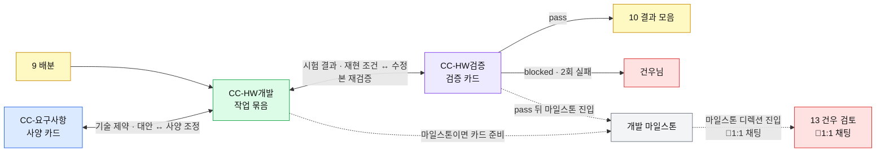

# HW 개발 구역 설계 — CC-HW개발과 CC-HW검증 (설계안)

> 한 줄 요지: 최종 흐름도의 개발 구역 중 **하드웨어 쪽 두 담당(CC-HW개발, CC-HW검증)** 을 정의하고, 두 담당이 시험 결과·재현 조건을 직접 주고받는 인계를 설계한다. 개발 마일스톤이 13 건우 검토(1:1)로 들어가는 규격은 [`docs/milestones.md`](./milestones.md) 에 둔다. 담당 정의 파일(`.claude/agents/hw-developer.md`, `hw-verifier.md`)은 반영됨(PR #34).

## 1. 범위

| 구분 | 내용 | 상태 |
|---|---|---|
| 담당 정의 | `.claude/agents/hw-developer.md`, `.claude/agents/hw-verifier.md` | 반영됨 (PR #34) |
| 인계·시험 설계 | 이 문서 | 반영됨 (PR #35) |
| 개발 마일스톤 | [`docs/milestones.md`](./milestones.md) | 반영됨 (PR #35) |
| 검증 실행기 | `Run-HwVerifier.ps1` + `prompt-hwverifier-template.txt` (PC 1 `_grr\autoloop\`, 저장소 밖) | 작성·단독 시험 완료, 자동 루프에는 미연결 |
| 자동 루프 연결 | `autoloop-hwverifier.patch.md` (같은 폴더) | 설계안, 미적용 (`Run-AutoLoop.ps1` 미수정) |
| 대상 제품 | 착용형 본체, 주변 장치, PCB/PCBA(품목은 PLM), 현장 검증 | 고정 |
| 제외 | PLM 자동 제출, 현장 일정 자동화 | 이후 단계 |

SW 쪽 담당(CC-요구사항, CC-SW검증)은 기존 설계를 따르고 이 문서에서 다시 정의하지 않는다. 요구사항 담당은 HW·SW가 공유한다.

## 2. 인계 흐름

흐름도 개발 구역의 하드웨어 노드와 같은 연결을 유지한다. 노드 문구·배치를 바꾸지 않는다.

## 3. 인계 계약

| 인계 | 입력 | 출력 | 방식 |
|---|---|---|---|
| 배분 → CC-HW개발 | 이슈 본문 + 사양 카드 | 작업 묶음(대상·변경 요지·산출물·시험 계획·검증 요청) | 이슈 또는 PR, `[CC-HW개발] 작업 묶음` |
| CC-HW개발 ↔ CC-요구사항 | 기술 제약·대안 | 사양 카드 개정본(바뀐 칸 먼저) | 같은 이슈 새 댓글, 이전 카드 유지 |
| CC-HW개발 → CC-HW검증 | 작업 묶음, 성적서·측정 자료 | 검증 카드(판정·기준별 결과·결함·미확인) | 댓글 `[CC-HW검증] 검증 카드` |
| CC-HW검증 → CC-HW개발 | `fail` + 재현 조건·측정값 | 수정본 + 결함 번호별 한 줄 | 같은 작업 묶음 회차 증가, 이전 묶음 유지 |
| CC-HW검증 → 10 결과 모음 | 마지막 줄 `HWVERIFIER_RESULT` | 결과 보고 | `pass`만 결과 모음. `blocked`·2회 `fail`은 건우님 |
| 개발 마일스톤 → 13 건우 검토 | 마일스톤 카드 | 판단·디렉션 | 10→11→12를 거치지 않음. 경로는 [`docs/milestones.md`](./milestones.md) |

- 세션이 직접 남기는 이슈·PR 댓글은 내부 인계 수단이다. PR 리뷰(승인·변경 요청)를 건우님 이름으로 남기지 않는다.
- 판정은 읽기·측정 기록 확인이다. 검증 담당은 설계 편집·커밋·푸시·병합·라벨 변경·PLM 제출을 하지 않는다.
- 없는 성적서·현장 자료를 추정하지 않는다. 확인하지 못한 것은 "확인 불가"와 사유로 적는다.

## 4. 시험 범위 (이 단계)

이 PR 은 설계 문서이다. 담당 정의 파일이 상 등급으로 반영된 뒤, 아래를 실제 과제 한 건으로 시험한다.

| 대상 | 확인할 것 |
|---|---|
| 작업 묶음 양식 | 칸이 모두 채워지고 `HWDEV_RESULT` 가 마지막 줄에 있는지 |
| 검증 카드 양식 | 기준별 판정과 재현 조건이 있고 `HWVERIFIER_RESULT` 가 마지막 줄에 있는지 |
| 직접 소통 | 결함 한 건을 수정본으로 돌려보내고 회차가 늘어나는지 |
| 마일스톤 진입 | 마일스톤 표시 묶음이 1:1 양식으로 13번에 들어가는지 |

## 5. 건우님 결정 사항

- 담당 정의 두 파일 반영: 완료 (PR #34, 주말 역할 정의 자율 반영)
- HW 검증 실행기를 자동 루프에 연결할지 (설계안 `autoloop-hwverifier.patch.md`, 미적용)
- 현장 검증·PLM 제출을 어떤 권한자가 실행할지
- 검증 모드를 읽기 전용에서 측정 명령 허용(`-Mode Full`)으로 올릴지

## 6. 검증 실행기 (저장소 밖, 루프 미연결)

- 위치: `PC 1 작업 폴더 _grr\autoloop\Run-HwVerifier.ps1`
- 동작: 읽기 전용. 작업 묶음·사양 카드·성적서를 모아 별도 세션(또는 `-Offline` 픽스처)으로 검증하고, `report.md` 와 `result.json` 을 남긴다. 병합·라벨 변경·PLM 제출·댓글(기본값)은 하지 않는다.
- 종료 코드: 0 `pass` / 1 `fail` / 2 `blocked` / 3 오류. 마지막 표준 출력 줄은 `HWVERIFIER_SUMMARY` JSON.
- 단독 시험: `powershell -File Run-HwVerifier.ps1 -SelfTest` — 픽스처 네 건(통과·실패·차단·오류), 실제 이슈·세션 없음.
- 루프 연결은 `autoloop-hwverifier.patch.md` 를 `Run-AutoLoop.ps1` 변경이 멈춘 뒤에 적용한다. `hw` 라벨이 있으면 이 실행기를, 없으면 기존 SW 검증기를 호출한다.

## 변경 이력

- 2026-11-27 — 자동 루프에 HW 검증 단계를 연결하는 경로를 시험함
