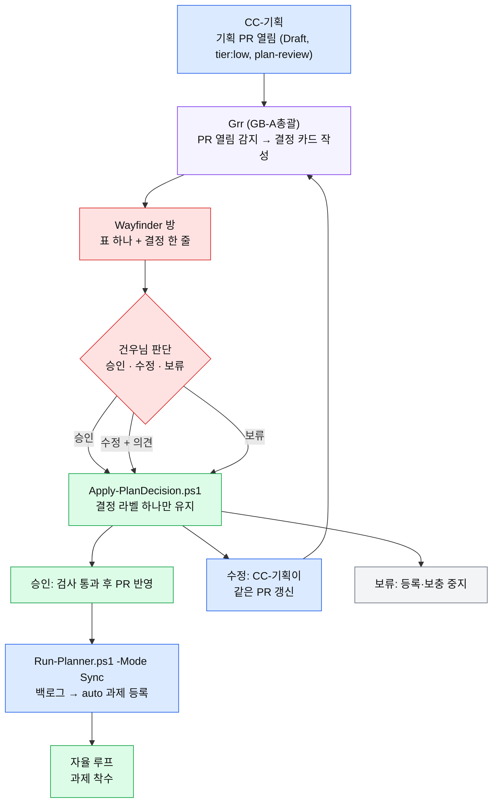

# 기획 검토 경로 — 흐름도 2·7 디스커션

> 한 줄 요지: CC-기획이 올린 기획 PR(`planning/` 문서)을 **한눈에 결정할 수 있는 카드**로 건우님에게 전하고(Grr = GB-A총괄, Wayfinder 방), 건우님의 승인·수정·보류 답을 **라벨 하나**로 PR 에 반영해 CC-기획과 자율 루프로 되돌리는 경로임. 큰 틀(승인·수정·보류)만 건우님이 정하고 이후는 자동으로 이어짐.

## 1. 경로



## 2. 라벨 체계

| 라벨 | 뜻 | 붙이는 쪽 | 비고 |
|---|---|---|---|
| `plan-review` | 건우님 검토 대기 기획 PR | CC-기획(PR 생성 시) | 결정 후에도 **유지**함. 동기화 도구가 이 라벨로 PR 을 찾음 |
| `plan-approved` | 승인 | 결정 반영 스크립트 또는 건우님이 GitHub 에서 직접 | 승인 시 백로그가 `auto` 과제로 등록됨 |
| `plan-revise` | 수정 요청(의견 댓글 필수) | 결정 반영 스크립트 또는 건우님 | CC-기획이 같은 PR 을 갱신하고 라벨을 뗌 |
| `plan-hold` | 보류 | 결정 반영 스크립트 또는 건우님 | 과제 등록·백로그 보충 중지 |
| `tier:low` | 기획 PR 의 반영 등급 | CC-기획 | 승인 즉시 반영 가능한 유일한 등급 |

- 결정 라벨(`plan-approved`·`plan-revise`·`plan-hold`)은 **한 번에 하나만** 둠. 스크립트가 나머지를 뗌
- `tier:critical` PR 은 이 경로로 결정·반영하지 않음. 건우님이 GitHub 에서 직접 판단함

## 3. PR 본문 필수 요소 — 결정 카드

본문 **맨 위**에 `## 결정 카드` 절을 두고 세 문장과 결정 요청 한 줄만 씀. 스크립트가 형식을 검사해 `card: ok | incomplete | missing` 으로 보고함.

```
## 결정 카드
- 문제: <지금 무엇이 막혀 있는지 한 문장>
- 해결안: <이 기획 PR 이 무엇을 정하는지 한 문장>
- 다음 단계: <승인하면 무엇이 일어나는지, 필요한 승인 포함 한 문장>
- 결정 요청: 승인 · 수정 · 보류 중 하나
```

- 세 문장 규칙: 문제 → 해결안 → 다음 단계(필요 승인). 문장마다 한 줄, 수식어와 배경 설명은 넣지 않음
- 결정 카드 아래에는 백로그 요약 표(번호 · 제목 · 등급 · 완료 조건 한 줄)를 두고, 세부는 `Files changed` 의 `planning/` 문서로 연결함
- 나쁜 소식(위험·미확정 항목)이 있으면 문제 문장에 먼저 씀

## 4. Grr 의 방 보고 틀 (GB-A총괄)

기획 PR 이 열리거나 갱신되면 Wayfinder 방에 아래 틀 그대로 올림. 틀은 바꾸지 않고 값만 바꿈([report-polish.md](./report-polish.md) 기준).

| 번호 | 항목 | 내용 |
|---|---|---|
| 1 | 기획 PR | 링크 · 회차 |
| 2 | 문제 | 결정 카드의 문제 문장 |
| 3 | 해결안 | 결정 카드의 해결안 문장 |
| 4 | 다음 단계 | 결정 카드의 다음 단계 문장 |
| 5 | 백로그 | 건수 · 등급별 건수 |

- 표 아래 **결정 한 줄**: `승인 / 수정(의견 한 줄) / 보류 중 하나로 답해 주세요`
- 답이 없으면 다른 작업을 계속하고, 다음 보고에 같은 틀로 대기 상태만 표시함

## 5. 답이 돌아오는 길

| 건우님 답 | Grr 가 PC 1 에서 실행 | 결과 |
|---|---|---|
| 승인 | `Apply-PlanDecision.ps1 -Pr <번호> -Decision approve -RunSync` | `plan-approved` 부착 → 검사 통과 시 반영 → 백로그가 `auto` 과제로 등록 |
| 수정 + 의견 | `... -Decision revise -Comment "<의견>"` | 의견 댓글 + `plan-revise` → CC-기획이 같은 PR 갱신 → Grr 가 다시 카드 작성 |
| 보류 | `... -Decision hold` | `plan-hold` → 등록·보충 중지 |
| 되돌림 | `... -Decision review` | 결정 라벨 제거, 검토 대기로 복귀 |
| 현황 | `... -Decision list` | 열린 기획 PR, 결정 상태, 카드 형식 검사 결과 |

- 스크립트 위치: `PC 1 작업 폴더 _grr\planner\Apply-PlanDecision.ps1`, 기록: 같은 폴더 `decision-log.txt`
- 건우님이 GitHub 에서 라벨을 직접 붙여도 같은 결과임. `Run-Planner.ps1 -Mode Sync` 가 라벨을 읽어 이어서 처리함
- 마지막 줄 `PLAN_DECISION_SUMMARY {json}` 과 종료 코드(0 완료, 1 가드 거절, 2 검사 실패·대기, 3 오류)로 결과를 읽음

## 6. 안전장치

- 승인 반영 조건: PR 열림 + `plan-review` + `tier:low` + `tier:critical` 아님 + 변경 파일이 모두 `planning/` 또는 `docs/` 아래 + 검사 통과. 하나라도 어긋나면 라벨만 붙이고 반영하지 않음
- 반영은 `--merge` 방식이며 브랜치는 삭제하지 않음
- PR 리뷰(승인·변경 요청)는 남기지 않음. 수정·보류 의견은 일반 댓글 한 개로만 전달하며 머리말은 `[GB-A 총괄 전달: 건우님 판단 의견]`
- 라벨과 댓글 외에는 PR 을 바꾸지 않음. 파일 수정은 CC-기획만 함

## 7. 시험 결과 (2026-11-27)

| 시험 | 결과 |
|---|---|
| 임시 기획 PR 에서 의견 없는 수정 요청 | 거절(종료 코드 1) |
| 의견과 함께 수정 요청 | 댓글 1개 + `plan-revise` 부착 |
| 수정 → 보류 → 승인(반영 생략) 순서 변경 | 매번 결정 라벨 하나만 남음 |
| 승인 가드 점검(반영 시늉) | 통과, 검사 통과 확인 |
| 결정 되돌림 | 결정 라벨 제거 |
| 열린 기획 PR 현황 | 2건 조회, 카드 형식 검사 표시 |
| `tier:critical` PR 에 승인 | 거절 |
| 임시 PR | 시험 후 닫음 |

## 8. 알려진 한계

- 실제 반영(`gh pr merge`) 호출은 임시 PR 을 저장소에 남기지 않으려고 시늉 모드로만 확인함
- `Run-Planner.ps1 -Mode Sync` 자체는 `plan-approved` PR 을 반영할 때 등급·경로를 다시 확인하지 않음. 이 경로는 스크립트의 가드가 있는 쪽을 쓰는 것이 안전함
- 예약 작업이 없어 라벨만 직접 붙인 경우의 동기화는 사람이 실행하거나 Grr 가 실행해야 함
- 결정 카드 검사는 형식만 확인함. 문장 내용의 질은 CC-기획과 Grr 가 책임짐
