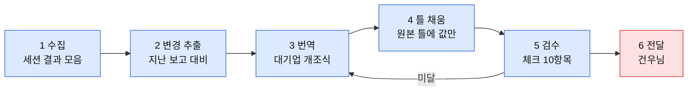

# 보고서 다듬기 규격 — 흐름도 12

> 한 줄 요지: 작업 담당 세션들이 낸 결과(과제 댓글, PR 상태, 검증 카드, 자동 루프 기록)를 **건우님이 한눈에 읽는 보고서**로 바꾸는 규격임. 틀은 매번 같고(제목 · 세 문장 · 흐름도 원본 · 표 하나 · 결정 한 줄), 바뀐 값만 갱신함. 담당은 GB-A총괄(Grr)이 정하고 GB-보고서가 작성하며, 형식 기준은 공용 스킬 `progress-report` 를 그대로 따름.

## 1. 위치

| 항목 | 내용 |
|---|---|
| 흐름도 위치 | 12 보고서 다듬기 → 13 건우 검토 |
| 담당 | GB-A총괄 → GB-보고서(작성) → 건우님(1:1 채팅 또는 프로젝트 방) |
| 입력 시점 | 10 결과 모음 이후, 11 판단 분기에서 "건우님 판단 필요"로 갈린 건 |
| 형식 기준 | 공용 스킬 `progress-report` (작성 시작 전에 스킬을 불러 최신 판을 따름) |
| 틀 파일 | [`docs/templates/report-polish-template.md`](./templates/report-polish-template.md) |

## 2. 처리 흐름

| 단계 | 하는 일 | 산출 |
|---|---|---|
| 1 수집 | 과제 세 문장 댓글, PR 상태·검사 결과, 검증 카드(`VERIFIER_RESULT`), 자동 루프 기록, 결정 카드를 읽음. 읽지 않은 것은 쓰지 않음 | 사실 목록 |
| 2 변경 추출 | 지난 보고의 틀과 대조해 상태가 바뀐 항목만 뽑음. 안 바뀐 항목은 표에 넣지 않음 | 변경 목록 |
| 3 번역 | 개발 용어를 업무 용어로 바꾸고 문장을 개조식 명사형으로 줄임(5절) | 문구 |
| 4 틀 채움 | 틀 파일을 복사해 제목 일시 · 세 문장 · 흐름도 표지 · 표 행 · 결정 한 줄만 채움 | 보고서 |
| 5 검수 | 7절 체크 10항목을 모두 통과해야 함. 미달이면 3단계로 돌아감 | 통과 보고서 |
| 6 전달 | 해당 주제의 방에만 올림. Wayfinder 주제는 Wayfinder 방, 개인 판단은 1:1 채팅 | 전달 완료 |

## 3. 틀 — 항상 이 순서, 이 구성

| 순서 | 구성 | 규칙 |
|---|---|---|
| 1 | 굵은 제목 한 줄 | `Wayfinder 진행 현황 (월-일 시:분 KST)` |
| 2 | 세 문장 | 문제 · 해결안 · 다음 단계(필요 승인 포함). 문장마다 한 줄 |
| 3 | 흐름도 원본 전체 | 노드 앞 상태 표지만 바꿈. 전체를 넣고 일부만 자르지 않음 |
| 4 | 표 하나 | 열: 구분 · 번호 · 항목 · 내용 · 변경. 변경된 항목만 행으로 둠, 행 수는 7개 이내 |
| 5 | 결정 한 줄 | 최대 한 줄. 요청이 없으면 줄째 생략 |

- 첨부 파일이 안 보이는 환경에서도 읽히도록 흐름도는 그림 파일이 아니라 코드 블록(mermaid)으로 직접 넣음
- 표의 `구분` 열은 `progress-report` 의 ①완료 ②진행 중 ③미착수 ④의사결정 요청 순서를 따름. 나쁜 소식(지연·실패)은 표 맨 위 행에 둠
- 길이는 한 화면 안. 넘치면 표 행을 줄이고 세부는 링크로 보냄

## 4. 흐름도 표지 규칙 — 틀을 바꾸지 않는다

| 표지 | 뜻 | 쓰는 곳 |
|---|---|---|
| 🟢 | 완료 | 노드 문구 맨 앞 |
| ⚠️ | 진행 중 | 노드 문구 맨 앞 |
| ❌ | 미착수 | 노드 문구 맨 앞 |
| 🆕 | 지난 보고 대비 변경 | 상태 표지 바로 뒤, 다음 보고에서 지움 |

- 바꿔도 되는 것: 노드 문구 맨 앞의 표지
- 바꾸지 않는 것: 노드 문구 · 연결선 · 연결 라벨 · 배치 · 묶음 · 색 정의(`classDef`). 색 정의에는 어두운 화면에서도 읽히도록 `color:#111111` 이 이미 들어 있음
- 틀을 바꿔야 할 이유가 생기면 보고서에서 바꾸지 않고 먼저 건우님께 확인함

## 5. 세 문장 규칙과 용어

- 문제: 지연·실패·막힌 것. 나쁜 소식이 있으면 반드시 첫 문장
- 해결안: 이번에 끝낸 일 또는 진행 중인 일
- 다음 단계: 다음에 할 일과 필요한 승인. 승인이 필요 없으면 "승인 불필요"로 씀
- 문장 끝은 개조식 명사형(~완료, ~구축, ~검증, ~함, ~예정). 한국어만 쓰고 영어 약어는 괄호 안 링크에만 둠

| 개발 용어 | 보고서 용어 |
|---|---|
| PR | 반영 요청 |
| 병합 | 반영 |
| 이슈 | 과제 |
| 세션 | 작업 담당 |
| 롤백·리버트 | 원복 |
| 검사 통과 | 점검 통과 |
| 블로커 | 지연 사유 |
| Draft | 초안 상태 |

## 6. 입력 원천과 읽는 법

| 원천 | 읽는 곳 | 보고서에 쓰는 것 |
|---|---|---|
| 과제 세 문장 댓글 | 과제의 마지막 댓글 | 문제 · 해결안 · 결과 |
| 반영 요청 상태 | PR 상태 · 점검 결과 | 완료 · 진행 중 판정 |
| 검증 카드 | PR 댓글 `[CC-SW검증] 검증 카드` | 통과 · 결함 · 확인하지 못한 것 |
| 자동 루프 기록 | `_grr\autoloop\log.txt` | 재처리 횟수 · 중단 사유 |
| 결정 카드 | 기획 PR 본문 | 건우님 판단 항목 |

- 원천에서 읽지 못한 값은 추정해서 채우지 않고 "확인 불가"로 쓰고 사유를 한 줄 덧붙임
- 건우님 이름으로 PR 리뷰·승인 의견을 남기지 않음

## 7. 검수 체크 10항목 — 전부 통과해야 전달

1. 제목에 일시(KST)가 있음
2. 세 문장이 문제 → 해결안 → 다음 단계 순서이고 각 한 줄임
3. 나쁜 소식이 있으면 첫 문장에 있음
4. 흐름도가 틀 파일과 표지만 다르고 전체가 들어 있음(노드 수·연결선 수 동일)
5. 상태 표지가 🟢 ⚠️ ❌ 셋뿐임
6. 표가 하나이고 열 이름·순서가 틀과 같음, 행 7개 이내
7. 결정 요청이 한 줄 이하이며 승인 시 일어나는 일이 적혀 있음
8. 꺾쇠 안에 설명이 든 빈칸(예: <월-일 시:분>)이 남아 있지 않음
9. 개발 용어가 5절 표대로 바뀌어 있음
10. 한 화면 안에 들어오고 한국어만 씀

## 8. 하지 않는 일

- 틀·흐름도·표 열을 새로 그리거나 줄이거나 바꾸는 것
- 결정 요청을 둘 이상 올리는 것(여럿이면 가장 큰 하나만 올리고 나머지는 다음 보고로 미룸)
- 읽지 않은 결과를 근거로 쓰는 것
- 대상 주제의 방이 아닌 곳에 보고하는 것
