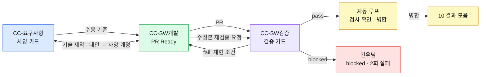

# SW 개발 구역 설계 — CC-요구사항과 CC-SW검증 (설계안)

> 한 줄 요지: 최종 흐름도의 개발 구역 중 **SW 쪽 두 담당(CC-요구사항, CC-SW검증)** 을 정의하고, 자동 루프가 PR 을 병합하기 전에 별도 세션이 독립 검증하는 단계를 설계한다. 이 PR 은 설계안이며 적용(자동 루프 수정)은 건우님 승인 뒤에 한다. HW개발·HW검증·개발 마일스톤은 4단계(확장)에서 다룬다.

## 1. 범위

| 구분 | 내용 | 상태 |
|---|---|---|
| 담당 정의 | `.claude/agents/requirements.md`, `.claude/agents/sw-verifier.md` | 이 PR |
| 검증 실행기 | `Run-Verifier.ps1` + `prompt-verifier-template.txt` (PC 1 `_grr\autoloop\`, 저장소 밖) | 작성·시험 완료, 자동 루프에는 미연결 |
| 자동 루프 연결 | `autoloop-verifier.patch.md` (같은 폴더) | 설계안, 미적용 |
| 제외 | CC-HW개발, CC-HW검증, 개발 마일스톤 | 4단계 |

## 2. 인계 흐름

## 3. 인계 계약

| 인계 | 입력 | 출력 | 방식 |
|---|---|---|---|
| 배분 → CC-요구사항 | 이슈 본문 | 사양 카드(목적·범위·수용 기준·등급·제약·미정) | 이슈 댓글 `[CC-요구사항] 사양 카드` |
| CC-SW개발 ↔ CC-요구사항 | 기술 제약·대안 | 사양 카드 개정본(바뀐 칸 먼저) | 같은 이슈 새 댓글, 이전 카드 유지 |
| CC-SW개발 → CC-SW검증 | PR 번호 | 검증 카드(판정·기준별 결과·결함·미확인) | `Run-Verifier.ps1 -Pr N`, PR 댓글 `[CC-SW검증] 검증 카드` |
| CC-SW검증 → CC-SW개발 | `fail` + 결함 목록 | 수정 커밋 + 결함 번호별 한 줄 | 자동 루프가 재시도 세션에 검증 카드를 입력으로 전달 |
| CC-SW검증 → 자동 루프 | 마지막 줄 `VERIFIER_RESULT` | 병합 또는 `needs-attention` | exit 0 pass / 1 fail / 2 blocked / 3 오류 |

- 세션이 직접 남기는 이슈·PR 댓글은 내부 인계 수단이다. PR 리뷰(승인·변경 요청)를 건우님 이름으로 남기지 않는다.
- 판정은 읽기 전용이다. 검증 담당은 코드 편집·커밋·푸시·병합·라벨 변경을 하지 않는다.

## 4. 시험 결과 (2026-11-27, 읽기 전용, 병합·댓글·라벨 변경 없음)

| 대상 | 판정 | 확인 내용 |
|---|---|---|
| PR #19 (병합됨, 문서 1줄) | pass | 기준 5개 모두 읽기 확인, 미확인 2건 명시, 거부된 도구 호출 0건 |
| PR #17 (미병합 종료, readme-skills 실패) | blocked | 제목 변경은 이슈대로이나 검사 실패의 원인(스크립트 정규식)과 이슈 범위 충돌을 정확히 지적 |

## 5. 건우님 결정 사항

- 담당 정의 두 파일 반영(`.claude/**` 변경이라 상 등급, Draft 로만 둠)
- 자동 루프 연결 적용 여부와 시점(`autoloop-verifier.patch.md`), tier:mid 를 검증 대상에 넣을지
- 검증 모드를 읽기 전용에서 시험 실행 허용으로 올릴지(허용 도구 범위 확대)
