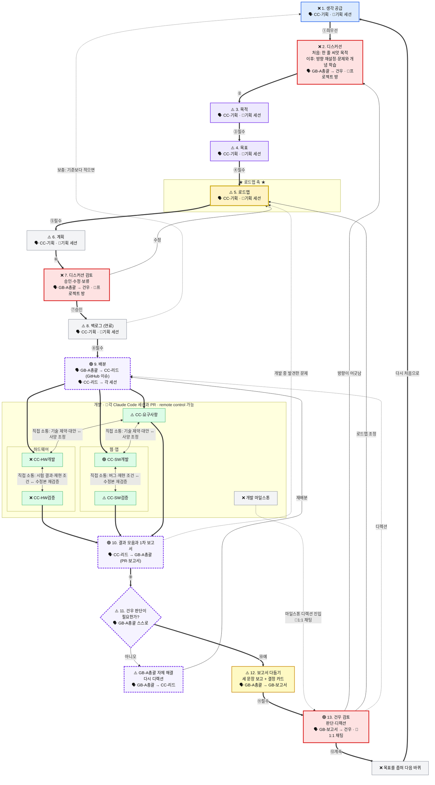

<!--
보고 틀 파일. 이 파일을 복사해 값만 바꾸고 틀은 바꾸지 않음.
- 바꾸는 곳: 제목의 일시, 세 문장, 흐름도 노드 앞 상태 표지(🟢 ⚠️ ❌)와 변경 표지(🆕), 표의 행, 결정 한 줄
- 바꾸지 않는 곳: 흐름도의 노드 문구·연결선·배치·classDef(color:#111111 포함), 표의 열 이름과 순서, 절 순서
- 전달 전에 꺾쇠 안에 설명이 든 빈칸(예: <월-일 시:분>)을 모두 값으로 채우고 하나도 남기지 않음. 이 주석은 지우고 보냄
-->
**Wayfinder 진행 현황 (<월-일 시:분> KST)**

- 문제: <지연·실패·막힌 것 한 문장. 없으면 "없음, 계획대로 진행 중">
- 해결안: <이번에 한 일 또는 하고 있는 일 한 문장>
- 다음 단계: <다음에 할 일과 필요한 승인 한 문장>

| 구분 | 번호 | 항목 | 내용 | 변경 |
|---|---|---|---|---|
| <①완료 · ②진행 중 · ③미착수 · ④의사결정 요청 중 하나> | <흐름도 번호 또는 담당명> | <항목명> | <한 줄, 핵심어와 숫자만> | <🆕 또는 이전 상태 → 현재 상태> |

**결정 요청:** <승인하면 무엇이 일어나는지 한 줄. 요청이 없으면 이 줄을 통째로 지움>
