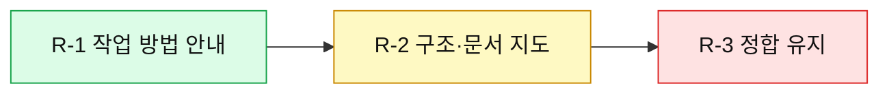

# 로드맵 (흐름도의 축)

> 한 줄 요지: 작업 방법 안내(R-1)는 완료, 구조·문서 지도(R-2)는 docs 링크만 남았고, 정합 유지(R-3)는 이번 회차에 범위를 확정해 착수함

| 번호 | 단계 | 연결 목표 | 완료 기준 | 상태 |
|---|---|---|---|---|
| R-1 | 작업 방법 안내 | G-1 | README 에 기획 폴더 절과 자율 루프 작업 흐름 절이 병합됨 | 완료 |
| R-2 | 구조·문서 지도 | G-1, G-2 | README 에 저장소 구조 절이 병합됨(완료)하고, `docs/` 문서 15개 전부가 README 에서 링크되며 끊어진 `docs/` 링크가 0건임 | 진행 중 |
| R-3 | 정합 유지 | G-3 | README 의 표·설명(PR 자동 검사·동기화 봇·허용 목록과 훅)이 실제 파일과 어긋난 곳이 0건임 | 미착수 |

## 변경 이력
- 2026-11-27 신규 작성. 시드 목적(README·docs 개선)을 3단계로 나눔. R-3 은 설정·검사 영역과 맞닿아 등급 판정이 필요하므로 다음 회차로 미룸
- 2026-11-27 보충 회차(4회차). README 확인 결과 기획 폴더·자율 루프 작업 흐름·저장소 구조 절이 이미 들어 있어 R-1 을 완료로, R-2 를 진행 중으로 바꿈. R-2 완료 기준의 docs 문서 수를 9개에서 15개로 정정함(이후 설계 문서가 추가됨). R-3 범위를 확정함: 동기화 봇 설명(자동 동기화가 꺼져 수동 실행만 가능한데 README 는 매주 자동이라 적음), PR 자동 검사 표의 누락 2행, 허용 목록 절의 훅 설명(훅이 이미 있는데 "쓰지 않고 있다"고 적음). 개발 중 발견된 문제 입력은 없음
