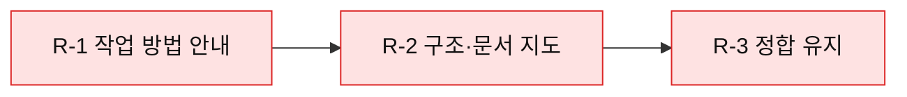

# 로드맵 (흐름도의 축)

> 한 줄 요지: 작업 방법 안내(R-1)를 먼저 갖추고, 저장소 구조·문서 지도(R-2)를 더한 뒤, README 와 실제 파일의 정합 유지(R-3)로 넘어감

| 번호 | 단계 | 연결 목표 | 완료 기준 | 상태 |
|---|---|---|---|---|
| R-1 | 작업 방법 안내 | G-1 | README 에 기획 폴더 절과 자율 루프 작업 흐름 절이 병합됨 | 미착수 |
| R-2 | 구조·문서 지도 | G-2, G-3 | README 에 저장소 구조 절이 병합되고 `docs/` 문서 9개 전부가 README 에서 링크됨 | 미착수 |
| R-3 | 정합 유지 | G-3 | README 의 표(PR 자동 검사·허용 목록·변경 이력)가 실제 파일과 어긋난 곳이 0건임. 다음 회차에서 범위 확정 | 미착수 |

## 변경 이력
- 2026-11-27 신규 작성. 시드 목적(README·docs 개선)을 3단계로 나눔. R-3 은 설정·검사 영역과 맞닿아 등급 판정이 필요하므로 다음 회차로 미룸
