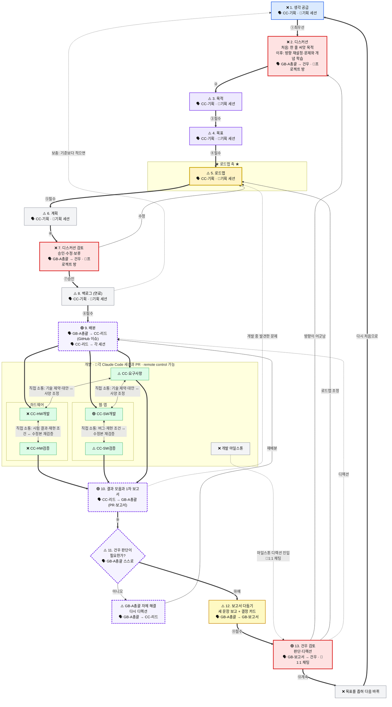

# 보고 기준서

> 한 줄 요지: **보고의 핵심은 틀을 바꾸지 않는 것임.** 확정된 그림·표·양식은 원본 그대로 쓰고, 바뀐 상태만 표시해 변경점부터 파악하게 함. 보고는 세 문장, 나쁜 소식 먼저, 한글 개조식으로 씀.

근거: 공용 스킬 `progress-report`, 11-27 건우님 지시(틀 불변·원본 첨부·한눈에 보기). 저장소 규칙 `.claude/rules/report-format.md`(합의 양식·용어)와 함께 적용하며, 겹치면 더 엄격한 쪽을 따름.

## ① 핵심 원칙

| 번호 | 원칙 | 기준 |
|---|---|---|
| 1 | 틀 불변 | 확정된 그림·표·양식은 노드·문구·배치·연결선·색·순서를 바꾸거나 줄이지 않음. 바꿀 사유가 있으면 바꾸기 전에 먼저 물음 |
| 2 | 변경점만 표시 | 상태 기호(🟢 ⚠️ ❌)와 변경 표시(🆕)만 덧붙임 |
| 3 | 원본 도표 첨부 | 현황 보고에는 흐름도 전체(상태 표시 포함)를 매번 같이 첨부함. "그림 기억하시죠"로 갈음하지 않음 |
| 4 | 표 하나, 결정 한 줄 | 표는 대상 하나에 하나, 칸에는 핵심어·숫자만. 의사결정 요청은 최대 한 줄 |
| 5 | 세 문장 | 문제 → 한 일 또는 제안 → 다음 단계와 필요한 허락 |
| 6 | 나쁜 소식 먼저 | 지연·실패·차단은 맨 위, 미루지 않고 즉시 보고 |
| 7 | 한글만 | 개조식 명사형 종결(~구축, ~완료, ~검증, ~함, ~예정). 영어 답변 금지 |

## ② 고정 보고 틀

```
**<제목 한 줄>**
- ① 완료
- ② 진행 중
- ③ 미착수
- ④ 의사결정 요청 (없으면 "없음")
```

- 지난 보고와 같은 제목·순서·항목명·표 열을 유지하고 바뀐 항목만 갱신함
- 한 항목은 한 줄, 세부는 최대 2단계 들여쓰기
- 채팅 보고는 한 화면 이내, 넘치면 링크로 뺌
- 의사결정 요청은 "무엇을 승인하면 무엇이 일어나는가"를 한 줄로 씀

## ③ 상태·변경 표시

| 표시 | 뜻 | 도표 색 |
|---|---|---|
| 🟢 | 완료 | 초록 `#dcfce7` |
| ⚠️ | 진행 중 | 노랑 `#fef9c3` |
| ❌ | 미착수·문제 | 빨강 `#fee2e2` |
| 🆕 | 지난 보고 대비 변경 | 노드 문구 앞에 덧붙임 |

- mermaid `classDef` 에는 다크 모드 가독성을 위해 반드시 `color:#111111` 포함
- 상태는 색뿐 아니라 기호로도 구분함

## ④ 세 문장 보고

1. **문제**: 무엇이 필요했거나 무엇이 어긋났는가
2. **한 일 또는 제안**: 무엇을 했는가, PR 링크와 등급 병기
3. **다음 단계와 필요한 허락**: 건우님 허락이 필요하면 한 줄, 없으면 "허락은 필요 없다"

## ⑤ 용어 치환 (대기업 보고서 용어)

| 쓰지 않음 | 씀 |
|---|---|
| PR 병합 | 반영 |
| 이슈 | 과제 |
| 세션 | 작업 담당 |
| 롤백·리버트 | 원복 |
| 블로커 | 지연 요인 |
| 승인해 주세요 | 승인 요청 |

- 개발 은어·영어 약어는 업무 용어로 바꾸고, 링크가 필요하면 괄호 안에 둠
- 상태 용어는 완료 / 진행 중 / 미착수 / 보류 / 지연으로 한정함

## ⑥ 흐름도 원본 (11-26 확정본, 11-27 16:00 KST 상태 표시)

현황 보고에 그대로 붙이는 원본임. 노드·연결선·색 정의는 바꾸지 않고 상태 기호만 갱신함.



- 위 그림의 상태 기호는 예시 시점 값이며, 보고할 때마다 실제 상태로 갱신함
- 노드별 색(`classDef`)은 담당·종류 구분이므로 상태 표시와 별개로 유지함

## ⑦ 점검표 (보고 전)

- [ ] 확정된 틀(제목·①~④·표 열·흐름도)을 그대로 썼음
- [ ] 바뀐 항목에만 상태 기호·🆕 표시를 붙였음
- [ ] 흐름도 전체를 상태 표시와 함께 첨부했음
- [ ] 나쁜 소식을 맨 위에 두었음
- [ ] 세 문장(문제·한 일·다음 단계와 허락)으로 정리했음
- [ ] 표 하나, 의사결정 요청 최대 한 줄임
- [ ] 한글 개조식, 용어 치환표를 지켰음
- [ ] mermaid `classDef` 에 `color:#111111` 이 있음
- [ ] 한 화면 이내임, 넘치면 링크로 뺐음
